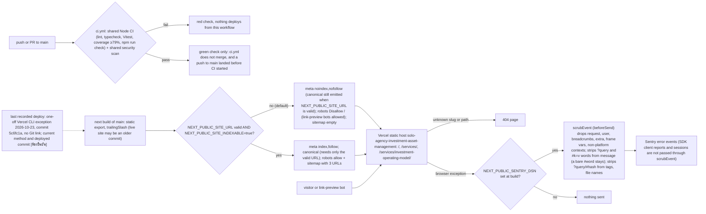
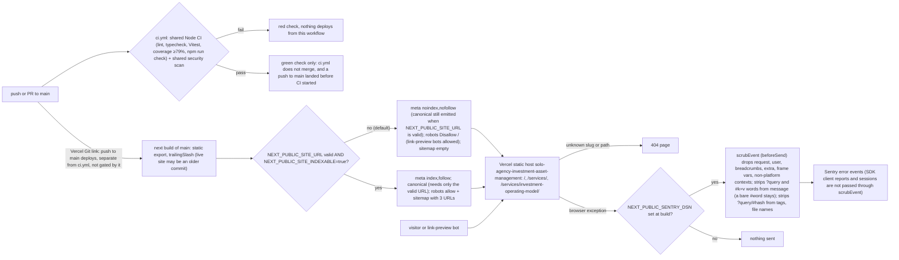

# 01 — Business process (As-Is / To-Be)

เว็บ Investment & Asset Management เป็น static showcase ภาษาไทยของ vertical นี้ (Next.js `output: 'export'`) มีหน้าแรก, `/services/` และหน้า service เดียว `/services/investment-operating-model/` ไม่มี form, API, ฐานข้อมูลหรือข้อมูลลูกค้า ผู้ชมคือผู้ซื้อที่อยากดูข้อเสนอและขอบเขตที่ยังไม่ขายจริง; owner เป็นคน build และ deploy

Last reviewed: 2026-11-28 · commit `b65975e`

## As-Is (จากโค้ดวันนี้)

Sources: `.github/workflows/ci.yml`, `next.config.ts`, `lib/site-config.ts`, `app/robots.ts`, `app/sitemap.ts`, `app/layout.tsx`, `app/services/[slug]/page.tsx`, `lib/sentry.ts`, `instrumentation-client.ts`, `PRODUCT.md`

ข้อเท็จจริงจากโค้ดและเอกสาร:

- `ci.yml` ไม่มี deploy step; การ deploy ไป Vercel ไม่อยู่ใน repo. `PRODUCT.md` (2026-10-23) บอกว่า Vercel project ไม่มี Git link และ deploy ด้วย CLI บันทึกดังกล่าวเป็นข้อยกเว้นครั้งเดียวสำหรับแพตช์ CVE (2026-10-23, commit 5c6fc1a) ไม่ใช่วิธี deploy ปกติ จึงเขียนเส้นประเป็นเหตุการณ์ย้อนหลัง; วิธี deploy ปัจจุบันและ commit ที่รันบน production [ต้องยืนยัน] จาก Vercel. PRODUCT.md ระบุว่า commit หลังจากนั้น (tests, Sentry, CI, docs, trailing-slash canonical) ยังไม่ถูก deploy จนกว่าจะเชื่อม Git จึงอ่านผังนี้เป็นพฤติกรรมของ build จาก `main` ไม่ใช่สถานะ live
- `isIndexable` ต้องมีทั้ง public URL ที่ผ่านการตรวจ (http/https, ไม่มี query/fragment/credentials) และ `NEXT_PUBLIC_SITE_INDEXABLE=true`; ไม่ครบจะเป็น noindex เสมอ; canonical แยกเงื่อนไข: `canonicalUrl()` ขึ้นกับ public URL ที่ผ่านการตรวจอย่างเดียว จึงมี canonical คู่กับ noindex ได้ (ไม่ใช่การตั้งค่าผิด)
- ค่า `NEXT_PUBLIC_SITE_URL` / `NEXT_PUBLIC_SITE_INDEXABLE` บน Vercel production ไม่อยู่ใน repo [ต้องยืนยัน]; `PRODUCT.md` (ข้อมูลวันที่ 2026-10-23) บอกว่ายังไม่ตั้ง
- `scrubEvent` (`lib/sentry.ts`) ตัด request, user, breadcrumbs, extra, vars ใน stack frame และ context ที่ไม่ใช่ platform; ตัด ?query และคำ `#key=value` ออกจาก message ตามรูปแบบที่ตรวจจับได้ (คำ `#fragment` เดี่ยวที่ไม่มี `=` ยังอยู่) และตัด ?query/#hash ออกจาก tag, ชื่อไฟล์ (ไม่ได้ตัดข้อความ error ส่วนอื่น); ไม่ส่ง trace/replay. `scrubEvent` ครอบเฉพาะ error event: `sentryOptions()` ไม่ได้ปิดค่าเริ่มต้นของ Browser SDK เช่น client report (เมื่อ event ถูกทิ้ง) และ session (เมื่อมี release) ซึ่งไม่ผ่าน `beforeSend` ผู้ดูแลควรตรวจจาก SDK ที่ติดตั้ง [ต้องยืนยัน]
- Sentry ปิดเมื่อไม่มี DSN; `PRODUCT.md` บอกว่าตั้ง DSN บน Vercel แล้วและมีผลเมื่อ deploy ครั้งถัดไป [ต้องยืนยัน]

## To-Be (PRODUCT.md §Live URL and deploy state)

เฉพาะสิ่งที่เขียนไว้: เมื่อ owner เชื่อม Vercel Git (owner action D9) การ push เข้า `main` จะ deploy ผ่าน Vercel Git โดยไม่ต้องรัน CLI (เป็นอีกเส้นทางหนึ่งแยกจาก `ci.yml` ไม่ถูก CI gate)

Sources: `PRODUCT.md` §Live URL and deploy state, §What does not work

## Gap

| ID | As-Is → To-Be | Status | Owner | Evidence |
|---|---|---|---|---|
| G1 | project `solo-agency-investment-asset-management` ไม่มี Vercel Git link, deploy ล่าสุดที่บันทึกคือ Vercel CLI ครั้งเดียวเป็นข้อยกเว้น (ตาม PRODUCT.md วันที่ 2026-10-23, ไม่ใช่ขั้นตอนปกติ) → เชื่อม Vercel Git ให้ push เข้า `main` deploy | decide | owner | `PRODUCT.md` §Live URL and deploy state (owner action D9); สถานะวันนี้ [ต้องยืนยัน] |
| G2 | indexing ปิด (`noindex`, `Disallow: /`, sitemap ว่าง) เพราะยังไม่มี public URL ที่อนุมัติ (ตามหลักฐาน PRODUCT.md 2026-10-23; ค่า env บน Vercel ปัจจุบัน [ต้องยืนยัน]) → ไม่มี To-Be ที่เขียนไว้ว่าจะเปิดเมื่อใด owner กำหนดเงื่อนไขและ URL | decide | owner | `PRODUCT.md` §What does not work (Indexing is off) |

## Open questions

- Vercel project `solo-agency-investment-asset-management` ยังไม่มี Git link อยู่จริงหรือไม่ และ production build ตั้ง `NEXT_PUBLIC_SITE_URL` / `NEXT_PUBLIC_SITE_INDEXABLE` ไว้หรือไม่ (ดูจาก Vercel เท่านั้น)
